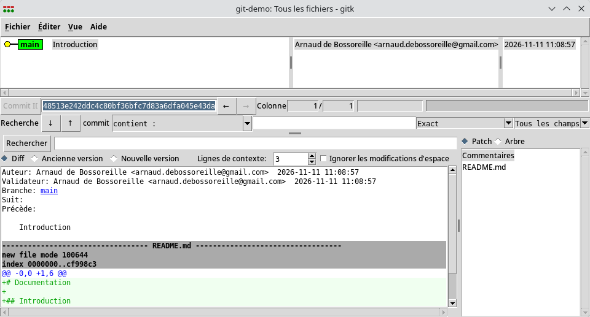
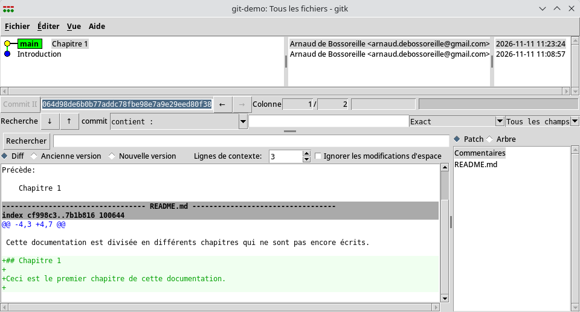
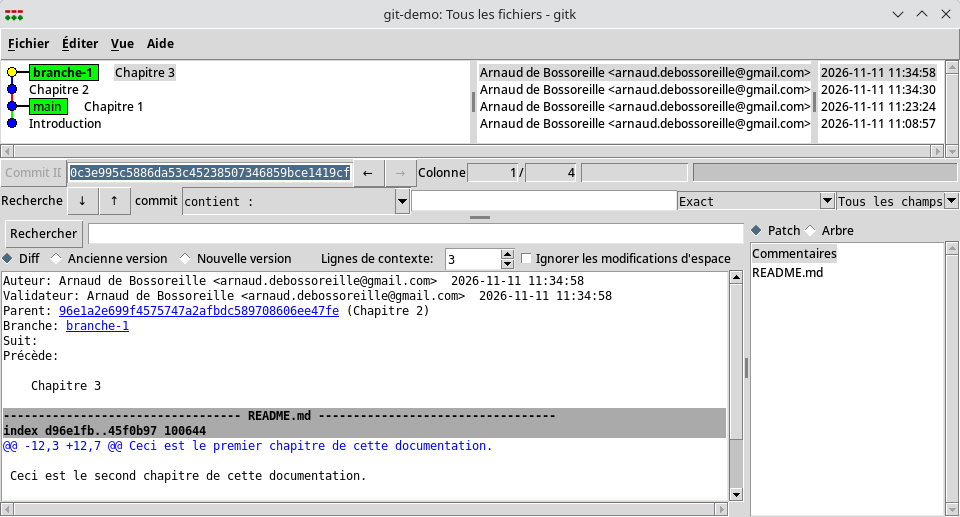
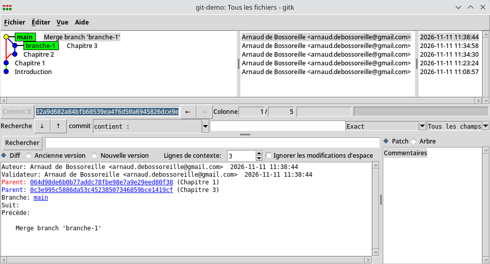
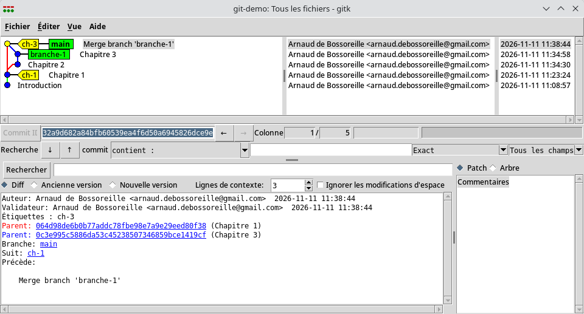
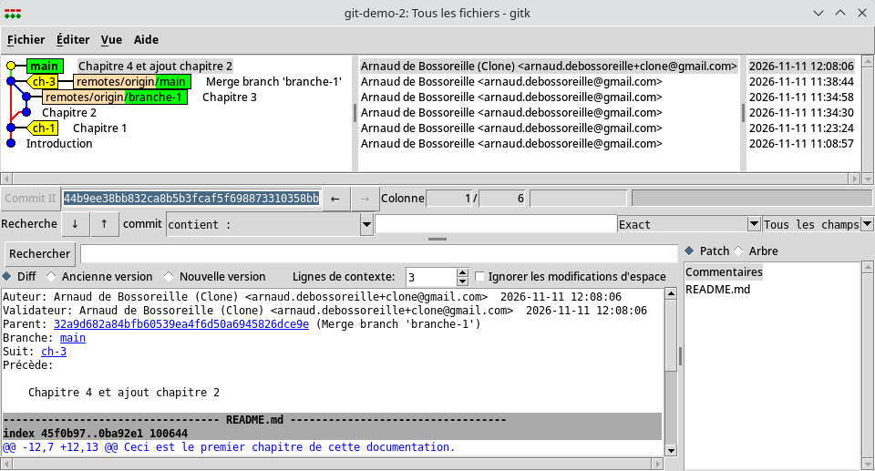
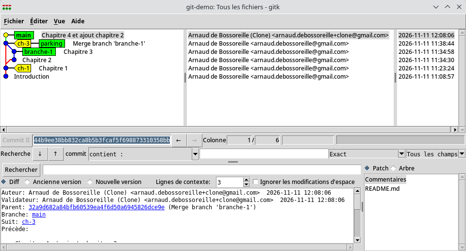

# Git & GitHub

## Introduction

Git...

* permet de gérer du code source (mais pas que), et particulièrement son évolution (versions)
* permet de partager du code source avec des amis, collègues, etc. (collaboration)
* s'utilise principalement en ligne de commande ou dans un IDE

GitHub...

* outil par dessus Git qui fluidifie la collaboration, notamment dans l'Open-Source (mais pas que)
* racheté par Microsoft après avoir été autonome avant
* fournit "GitHub Desktop"... sauf sous Linux :-/

## Git en local

On parle de "Dépôt" Git. Un dépôt Git est principalement composé:

* d'une base de données qui contient toutes les informations sur l'histoire de votre code
* d'une "copie locale" qui permet d'éditer le contenu à un instant donné
* d'un peu de configuration

### Création d'un dépôt

On veut d'abord initialiser un dépôt Git.

```shell
mkdir git-demo
cd git-demo
git init
```

La base de données est dans `.git` et ses sous-répertoires.

La copie locale c'est tout sauf `.git`, au début il n'y a rien.

`.git` contient aussi la configuration.

### Commit

Ensuite on veut ajouter du contenu dans notre dépôt et l'enregistrer comme un état connu dans l'histoire du dépôt.

* un "commit" est la représentation de cet état
* il contient toutes les différences entre l'état précédent et l'état qui est enregistré
* il possède un identifiant pour le retrouver, il est unique

Pour créer un commit, il faut d'abord créer le contenu dans la "copie locale": `README.md`

```markdown
# Documentation

## Introduction

Cette documentation est divisée en différents chapitres qui ne sont pas encore écrits.

```

Ensuite il faut dire à Git ce que l'on souhaite mettre dans le commit


```shell
git add README.md
```

Ceci a pour conséquence de mettre son contenu actuel dans l'"index" (ou le "cache"). L'index est un espace transitoire dans lequel se trouve tout ce qui doit aller dans le commit et uniquement cela.

Enfin il faut créer le commit:

```shell
git commit
```

On peut maintenant visualiser ce commit avec un outil graphique.



On voit:

* un commit avec son message
* le nom de la branche courante (`main`)
* l'auteur
* la date de création
* l'identifiant du commit
* le contenu

### Ajouts

Pour ajouter du contenu, il suffit de répéter les opérations:

* édition dans la copie locale
* mise dans l'index
* commit



### Branche

Lorsque l'on veut effectuer plusieurs modifications pour les partager plus tard, il suffit de créer une branche:

```shell
git checkout -b branche-1
```



* la branche 1 contient 2 ajouts
* la branche principale n'a pas bougée

### Fusion (Merge)

Lorsqu'on est content du résultat, on "fusionne" la branche dans la principale:

```shell
git checkout main
git merge --no-ff branche-1
```



* la branche 1 n'a pas bougé
* la branche principale a reçu les modifications apportées par la branche 1
* sans `--no-ff`, il n'y aurait pas eu de "commit de fusion" et seule une ligne droite apparaîtrait dans le graphe (et ça serait beaucoup moins drôle)
* le commit de fusion a 2 parents

### Étiquette (Tag)

Pour pouvoir accéder plus rapidement à une version sans se rappeler des identifiants de commits (qui sont quasi aléatoires), il est possible de poser une étiquette sur un commmit:

```shell
git tag ch-3
git tag ch-1 064d98de6b0b77addc78fbe98e7a9e29eed80f38
```



* `ch-3` est placé sur la "tête" de la branche principale (la branche courante)
* `ch-1` est placé sur un commit identifié comme intéressant

## Git en distribué

### Clone

Il est possible d'avoir une seconde copie locale, totalement indépendante de la première, tout en ayant quand même un lien entre les deux:

```shell
# Dans un autre terminal
git clone git-demo git-demo-2
```

* `git-demo-2` contient tout ce qui se trouve dans `git-demo`
* il a son propre `.git`, ce qui le rend totalement indépendant
* il possède un lien vers le dépôt d'origine, il apparaît dans `.git/config`

### Commit dans le clone

On ajoute un commit dans le clone:



* le commit est dans la branche principale
* les branches principales ont divergé

### Poussée

Pour que l'origine puisse profiter de ces ajouts, on pousse la branche principale vers l'origine (dont le clone connaît l'emplacement):

```shell
git push
```

Ceci ne fonctionne pas aussi facilement car Git détecte que l'origine est en train de travailler dans la branche principale. Pour contourner cela temporairement, il suffit de placer l'origine dans une autre branche.

Une fois poussés les changements, l'origine y a accès:



* les commits sont littéralement identiques, y compris leurs identifiants
* la copie locale est mise à jour

